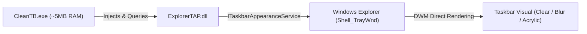

# CleanTB 🪟⚡

> **Ultra-Lightweight, Bloat-Free Taskbar Customizer for Windows 11 and Windows 10**  
> *~5 MB RAM • Zero Telemetry • Pure Native Explorer Pipeline • Instant Tray Toggle*

[](https://github.com)
[](https://dotnet.microsoft.com/)
[](#-performance-benchmark)
[](#-privacy--zero-telemetry)
[](LICENSE)

---

## 📖 Overview

**CleanTB** is a minimalist, ultra-high-performance taskbar customizer engineered specifically to solve the bloat problem of modern desktop customization tools.

While popular utilities like TranslucentTB provide great visual effects, their recent versions bundle heavy UI runtimes (WinUI 3 / XAML Islands, `Xaml.dll`, `resources.pri`), MSIX package virtualization overhead, and background telemetry logging (`ProgramLog.dll`), frequently idling at 30 MB to 70 MB of RAM.

**CleanTB strips all of that away.** 

By interacting directly with the native Windows Shell diagnostics and taskbar appearance pipeline (`ITaskbarAppearanceService` injected via `ExplorerTAP`), CleanTB delivers identical, fluid taskbar effects with **over 85% less memory usage**, instant startup, and zero background I/O.

---

## ⚡ Performance Benchmark

| Metric / Feature | Standard TranslucentTB (Store/MSIX) | CleanTB (Rebuilt) |
| :--- | :--- | :--- |
| **Idle Memory (RAM)** | ~30 MB – 70 MB | **~5 MB – 8 MB** *(~85% reduction)* |
| **UI Framework Overhead** | Heavy WinUI 3, XAML Islands, `Xaml.dll` | **Zero UI bloat** (pure Windows message pump) |
| **Telemetry & Disk I/O** | Active (`ProgramLog.dll` writes to disk) | **Zero telemetry, 100% offline** |
| **Binary & Dependencies** | Dozens of DLLs + Virtualized Registry | **Standalone, single-folder executable** |
| **Tray Quick Action** | Opens sluggish XAML flyout | **Instant 1-click toggle (Clear ↔ Default)** |
| **Multi-Monitor** | Yes | **Yes** (`Shell_TrayWnd` + secondary monitors) |
| **Crash Protection** | Process dies safety net | **Automated recovery on explorer restart** |

---

## ✨ Features

- **🪟 Visual Presets**:
  - **Clear (100% Transparent)**: Eliminates taskbar background entirely for full desktop wallpaper immersion.
  - **Blur**: Classic Fluent Glass frosted background effect.
  - **Acrylic**: Modern Windows 11 desktop backdrop blur with light diffusion.
  - **Tinted Dark**: 40% translucent dark overlay for clear visibility against vibrant wallpapers.
  - **Tinted Light**: 40% translucent light overlay for high-contrast dark themes.
  - **Normal**: Restores standard Windows taskbar rendering on demand.
- **📏 Border Line Toggle**: Hide or restore the subtle 1px border line Windows 11 draws across the top of the taskbar.
- **🖥️ Multi-Monitor Support**: Automatically styles both primary (`Shell_TrayWnd`) and all connected secondary monitor taskbars (`Shell_SecondaryTrayWnd`).
- **🛡️ Explorer Crash & Display Change Recovery**: Automatically detects `TaskbarCreated` broadcast messages and `WM_DISPLAYCHANGE` events, cleanly re-applying effects if Windows Explorer restarts.
- **🚀 Run at Startup**: One-click toggle in the tray menu to automatically start CleanTB with Windows via `HKCU\Software\Microsoft\Windows\CurrentVersion\Run`.
- **⚡ Left-Click Quick Toggle**: Left-click the system tray icon to instantly toggle between **Clear** and **Normal** without opening any menus.
- **📊 Real-Time Taskbar Hardware Stats HUD**:
  - Live **Network Speed** (Upload ▲ / Download ▼), **CPU %**, and **RAM %** (plus optional GPU) rendered directly on your taskbar.
  - Docks smoothly next to your system clock / tray icons with modern Windows 11 Fluent typography.
  - **Double-click** the stats HUD to instantly launch Windows Task Manager (`taskmgr.exe`).
  - **Drag & Drop** to reposition the HUD anywhere, or reset to auto-dock from the tray menu.
  - Built with pure native Win32 kernel calls (`GetSystemTimes`, `GlobalMemoryStatusEx`) consuming `< 0.1% CPU` and `~1.5 MB RAM`.
- **🔒 Single Instance Guard**: Protected by a native system mutex to prevent accidental duplicate instances.

---

## 🎮 How to Use

CleanTB runs unobtrusively in your **System Tray** (near the clock):

- **Left-Click Tray Icon**: Instantly toggles between **Clear (Transparent)** and **Normal**.
- **Right-Click Tray Icon**: Opens the context menu to:
  - Select any taskbar style preset (**Clear**, **Blur**, **Acrylic**, **Tinted Dark**, **Tinted Light**, **Normal**)
  - Toggle **Hide Top Border** on/off
  - Enable or disable **Start with Windows**
  - **Exit** cleanly (safely restoring default Windows taskbars)

---

## 🏗️ Architecture & How It Works

CleanTB bypasses bulky UI frameworks by targeting Windows internal Shell interfaces:

1. **Explorer TAP Hook**: Injects `ExplorerTAP.dll` into the desktop window station (`Shell_TrayWnd`).
2. **Direct COM Interface**: Acquires a handle to `ITaskbarAppearanceService` (GUID `5bcf9150-c28a-4ef2-913c-4c3ea2f5ead0`).
3. **Appearance Methods**: Calls direct unmanaged methods:
   - `SetTaskbarAppearance(taskbarHwnd, brush, color)`
   - `SetTaskbarBlur(taskbarHwnd, color, blurAmount)`
   - `SetTaskbarBorderVisibility(taskbarHwnd, visible)`
   - `ReturnTaskbarToDefaultAppearance(taskbarHwnd)`
4. **Window Message Loop**: Maintains an ultra-lightweight WinForms `ApplicationContext` listening for tray interactions and shell notification broadcasts.



---

## 🛠️ Building from Source

### Prerequisites
- Windows 10 (1809+) or Windows 11
- [.NET 8.0 SDK](https://dotnet.microsoft.com/download/dotnet/8.0)
- Visual Studio 2022 or VS Code (optional)

### Build Steps

```powershell
# Clone the repository
git clone https://github.com/GHOSTIEx9/CleanTB.git
cd CleanTB

# Build Release binary
dotnet build -c Release

# The compiled output will be located in:
# bin/Release/net8.0-windows/
```

---

## 🔐 Privacy & Zero Telemetry

CleanTB is built with a strict offline, zero-telemetry policy:
- No internet access or network sockets
- No telemetry, analytics, or behavioral logging
- Preferences stored locally in `config.json`
- Full policy available in [PRIVACY.md](PRIVACY.md)

---

## 📄 License

This project is open-source software licensed under the [MIT License](LICENSE).
